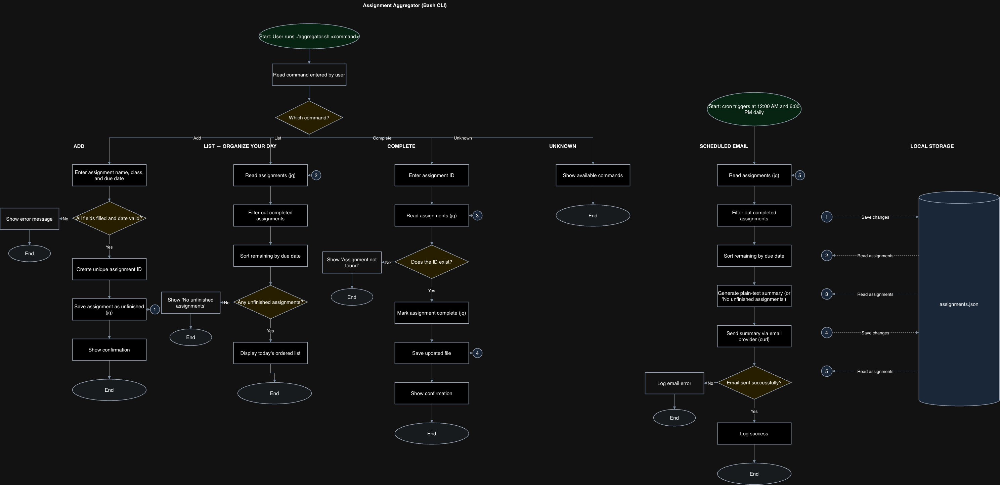

# Assignment Aggregator

## Project Goal

Most, if not all my classes host their assignments in different places (BrightSpace, word-of-mouth, TopHat, etc). This was a major problem for me, especially at the beginning of the year, since I was new to all of these platforms. It's risky because they all live in different places, so there's a chance I might miss an assignment.

## What I Am Building

I am going to build an assignment aggregator that will combine all of my assignments and send me an email at 12AM and 6PM daily about updates. The assignments will be entered manually, but the app will allow you to mark them as complete and organize your day accordingly.

## MVP Scope

- Manually add assignments with a name, class, and due date.
- List unfinished assignments in due-date order.
- Mark assignments as complete using their ID.
- Send a plain-text email summary at 12AM and 6PM daily.

## Future Plans

- Edit assignment details after adding them.
- Filter assignments by class.
- Highlight assignments due within 24 hours.

## Tech Stack

- bash - commands, logic
- jq (JSON) - read/update completion status
- curl - send plain-text summary via email provider
- terminal, git, GitHub
- cron - email scheduling

Assignments will be stored locally in `data/assignments.json`. The data will come from assignments I enter manually from course platforms and class announcements.

Email delivery will need an SMTP provider and credentials stored outside the repository. The computer needs to be running for cron to send the scheduled emails.

## Build Plan

Each step will be one Git commit.

1. Set up GitHub repo, README
2. Write a sample JSON
3. Add a command for saving new assignments, checks for correctly formatted dates
4. Add a command for listing unfinished assignments in due-date order
5. Add a command that marks assignments complete using its ID
6. Generate plain-text summary of unfinished assignments
7. Connects summary to email provider
8. Test complete workflow, iterate

I will also set up cron in step 7.

## Planning Documents

- [Design document](docs/design-doc.md)
- [Eisenhower Matrix](docs/eisenhower-matrix.md)
- [System Diagram - editable source](docs/system-diagram.drawio)

Open the `.drawio` file in diagrams.net to view or edit it.

## Folder Structure

- `docs/` - design document, matrix, and system diagram
- `data/` - local assignment data; sample JSON will be added in step 2
- `tests/` - workflow checks to add during development
- `aggregator.sh` - planned main script, to be added during implementation

## Project Status

I have set up the repo and planned the project. I haven't started writing the script yet.

