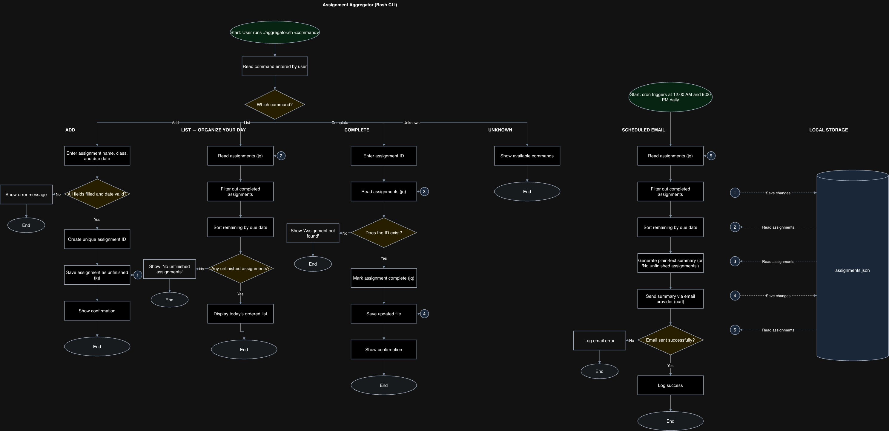

# Assignment Aggregator - Design Document

## GitHub Repository

https://github.com/eahunigan/assignment-aggregator

## Problem

Most, if not all my classes host their assignments in different places (BrightSpace, word-of-mouth, TopHat, etc). This was a major problem for me, especially at the beginning of the year, since I was new to all of these platforms. It's risky because they all live in different places, so there's a chance I might miss an assignment.

## Solution

I am going to build an assignment aggregator that will combine all of my assignments and send me an email at 12AM and 6PM daily about updates. The assignments will be entered manually, but the app will allow you to mark them as complete and organize your day accordingly.

## MVP

- Manually add assignments with a name, class, and due date.
- List unfinished assignments in due-date order.
- Mark assignments as complete using their ID.
- Send a plain-text email summary at 12AM and 6PM daily.

## Eisenhower Matrix

See [the completed matrix](eisenhower-matrix.md).

## Tech Stack

- bash - commands, logic
- jq (JSON) - read/update completion status
- curl - send plain-text summary via email provider
- terminal, git, GitHub
- cron - email scheduling

- Data storage - `data/assignments.json`, with an ID, name, class, due date, and completion status for each assignment.
- Data source - assignments entered manually from course platforms and class announcements.
- Email configuration - SMTP credentials kept outside GitHub.
- Scheduling - the computer must be running at the scheduled times.

## Milestones

1. Set up GitHub repo, README
2. Write a sample JSON
3. Add a command for saving new assignments, checks for correctly formatted dates
4. Add a command for listing unfinished assignments in due-date order
5. Add a command that marks assignments complete using its ID
6. Generate plain-text summary of unfinished assignments
7. Connects summary to email provider
8. Test complete workflow, iterate

Step 7 also includes setting up the cron schedule.

## System Diagram

[Editable diagram source](system-diagram.drawio)

The diagram shows the commands and scheduled emails. Matching numbers show which steps read or update the JSON file.

## Future Plans

- Edit assignment details after adding them.
- Filter assignments by class.
- Highlight assignments due within 24 hours.

